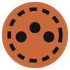

<div align="center">



<p>
  
  
  
  
  
</p>

<i>"Nenhuma alma passa pelos portões sem que eu saiba seu nome."</i>

</div>


## Sobre o projeto

**Cerberus** é um site sobre a **mitologia grega**: deuses, heróis, criaturas, mitos e lugares lendários.

Quem conduz o visitante é o **Cerberus**, o cão de três cabeças que guarda os portões do Hades. Ele é a persona do site: recebe quem chega, apresenta as histórias e acompanha a jornada pelo mundo dos mitos.

> O Cerberus é o guia. O tema é toda a mitologia grega.


## O que você vai encontrar

<table>
  <tr>
    <td align="center" width="25%"><b>Deuses</b><br/><sub>Zeus, Hades, Poseidon e os olimpianos</sub></td>
    <td align="center" width="25%"><b>Heróis</b><br/><sub>Héracles, Perseu, Aquiles, Odisseu</sub></td>
    <td align="center" width="25%"><b>Criaturas</b><br/><sub>Medusa, Hidra, Minotauro e o próprio Cerberus</sub></td>
    <td align="center" width="25%"><b>Lugares</b><br/><sub>Olimpo, Submundo, Tártaro, Campos Elísios</sub></td>
  </tr>
</table>


## Estrutura

```
projeto-individual-cerberus/
├── public/          # frontend
│   ├── css/         # estilos
│   ├── img/         # imagens
│   └── js/          # scripts
├── src/             # API em Node.js
├── database/        # scripts SQL (modelo e comandos)
└── docs/            # documentação, assets e Diário de Prompts
```


## Tecnologias

| Camada | Tecnologia |
|---|---|
| Estrutura | HTML5 |
| Estilo | CSS3 |
| Interação | JavaScript |
| Servidor | Node.js |
| Banco de dados | SQL |


## Identidade visual

| Cor | Hex | Uso |
|---|---|---|
| Preto | `#050505` | Fundo, o escuro do Submundo |
| Vermelho | `#ff1a1a` | Destaques, fogo, os olhos do Cerberus |
| Vermelho sangue | `#8b0000` | Detalhes e sombras |
| Verde | `#2bff6a` | Raro: aparece de vez em nunca, como um sinal |


## Roteiro

- [x] Estrutura inicial do repositório
- [x] README e identidade visual
- [ ] Página inicial com a apresentação do Cerberus
- [ ] Páginas de deuses, heróis, criaturas e lugares
- [ ] Interações em JavaScript
- [ ] Modelagem do banco de dados
- [ ] API em Node.js


## Diário de Prompts

O uso de IA neste projeto está registrado em [`docs/diario-de-prompts.md`](docs/diario-de-prompts.md).

<br/>

<div align="center">



<sub>Projeto Individual · <b>enzofuchsb</b></sub>

</div>
