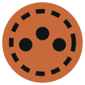

<div align="center">



<p>
  
  
  
  
  
</p>

<i>"Nenhuma alma passa pelos portões sem que eu saiba seu nome."</i>

</div>


## Sobre o projeto

**Cerberus** é um site sobre a **mitologia grega**: deuses, heróis, criaturas, mitos e lugares lendários.

Quem conduz o visitante é o **Cerberus**, o cão de três cabeças que guarda os portões do Hades. Ele é a persona do site: recebe quem chega, apresenta as histórias e acompanha a jornada pelo mundo dos mitos.

> O Cerberus é o guia. O tema é toda a mitologia grega.


## O que você vai encontrar

<table>
  <tr>
    <td align="center" width="25%"><b>Deuses</b><br/><sub>Zeus, Hades, Poseidon e os olimpianos</sub></td>
    <td align="center" width="25%"><b>Heróis</b><br/><sub>Héracles, Perseu, Aquiles, Odisseu</sub></td>
    <td align="center" width="25%"><b>Criaturas</b><br/><sub>Medusa, Minotauro, Hidra, Quimera e o próprio Cerberus</sub></td>
    <td align="center" width="25%"><b>Lugares</b><br/><sub>Olimpo, Delfos, Troia, Ítaca, Aqueronte</sub></td>
  </tr>
</table>


## Funcionalidades

**Para todos**
- Página inicial com o Cerberus, um desafio rápido e o portão que pede o seu nome.
- Listas de **deuses, heróis, criaturas e lugares**, com uma página de história para cada um (37 histórias).
- **História do Dia** (Perséfone e a romã), com uma pergunta no final.
- **Mito no dia a dia**: palavras e marcas que vieram dos mitos, com filtro.
- **Mini Cerberus** no canto da tela, que fala uma frase a cada clique.

**Com login** (cadastro e login guardados no banco)
- **Marcar como lida** cada história.
- **Avaliar de 1 a 5 cerberinhos** depois de ler: clicar no 3º acende os 3 primeiros.
- **Favoritar e desfavoritar** histórias.
- Perfil **Minha Jornada**: total de lidas, de favoritos e média das notas; gráfico de rosca com as lidas por categoria; gráfico de barras com as 5 histórias mais bem avaliadas do site; e a lista dos favoritos.


## Banco de dados

Script completo em [`database/script.sql`](database/script.sql) (tabelas, dados de teste e os SELECTs do dashboard).

```
usuario 1 ───< N leitura  N >─── 1 historia
usuario 1 ───< N favorito N >─── 1 historia

usuario  (id PK, nome, email UNIQUE, senha)
historia (id PK, nome, categoria, pagina)
leitura  (fk_usuario + fk_historia = PK, nota INT NULL de 1 a 5, data_hora)
favorito (fk_usuario + fk_historia = PK, data_hora)
```

`usuario` e `historia` têm relacionamento **N:N** duas vezes: pela tabela `leitura` (quem leu e que nota deu) e pela tabela `favorito`.

Usuário de teste: `teste@cerberus.com` / `12345678`.


## Estrutura

```
projeto-individual-cerberus/
├── app.js           # servidor Express
├── public/          # frontend: páginas HTML
│   ├── css/         # estilos
│   ├── img/         # imagens
│   └── js/          # historia-acoes.js, perfil.js, conta.js, cerberus.js...
├── src/             # API em Node.js
│   ├── routes/      # usuarios.js e historias.js
│   ├── controllers/ # usuarioController e historiaController
│   └── models/      # usuarioModel e historiaModel
├── database/        # script.sql (modelo, dados de teste e SELECTs)
└── docs/            # documentação, assets e Diário de Prompts
```


## Tecnologias

| Camada | Tecnologia |
|---|---|
| Estrutura | HTML5 |
| Estilo | CSS3 |
| Interação | JavaScript |
| Servidor | Node.js |
| Banco de dados | MySQL |
| Gráficos | Chart.js |


## Identidade visual

| Cor | Hex | Uso |
|---|---|---|
| Escuro | `#121417` | Topo, cartões e rodapé |
| Mármore | `#e9ebee` | Fundo claro das seções, a pedra dos templos |
| Terracota | `#c8693a` | Cor principal, inspirada nos vasos gregos |
| Âmbar | `#f2b632` | Destaques no escuro e os olhos do Cerberus |
| Vermelho | `#b0241b` | Detalhe raro, as coleiras do Cerberus |

**Tipografia:** [Cinzel](https://fonts.google.com/specimen/Cinzel) nos títulos, inspirada nas inscrições gregas, e [Nunito Sans](https://fonts.google.com/specimen/Nunito+Sans) no texto.

O Cerberus do site é um cão de três cabeças com coleiras vermelhas, apresentado sobre o fundo escuro do Submundo.


## Roteiro

- [x] Estrutura inicial do repositório
- [x] README e identidade visual
- [x] Página inicial com a apresentação do Cerberus
- [x] Páginas de deuses, heróis, criaturas e lugares
- [x] Interações em JavaScript
- [x] Modelagem do banco de dados
- [x] API em Node.js


## Diário de Prompts

O uso de IA neste projeto está registrado em [`docs/diario-de-prompts.md`](docs/diario-de-prompts.md).

<br/>

<div align="center">



<sub>Projeto Individual · <b>enzofuchsb</b></sub>

</div>
